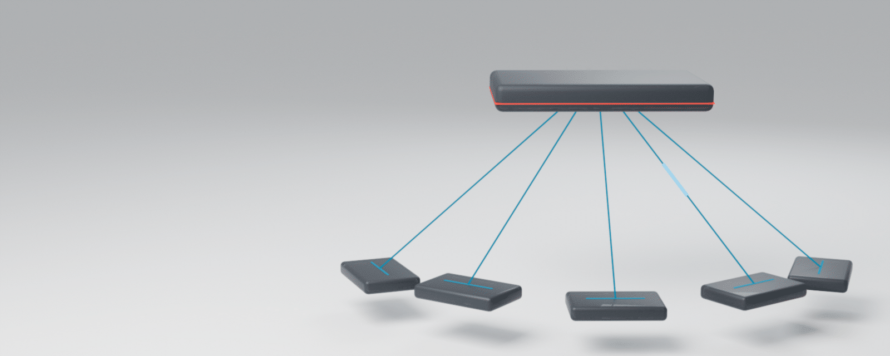
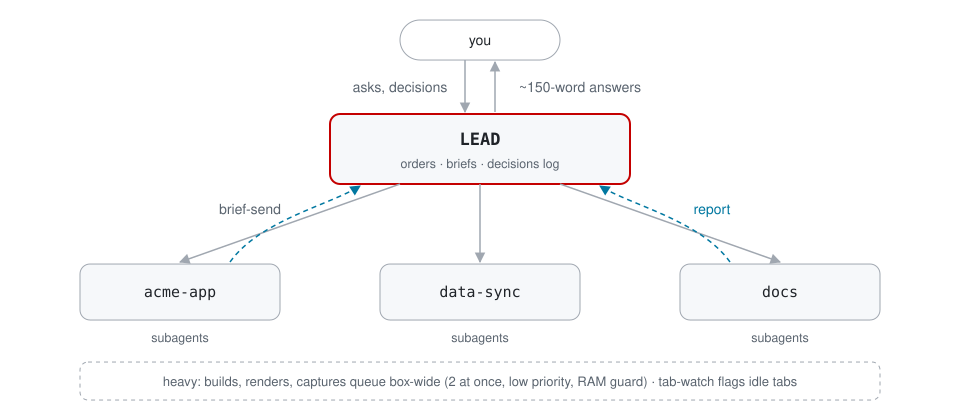

<p align="center">
  <picture>
    <source media="(prefers-color-scheme: dark)" srcset="assets/hero/hero-dark.png">
    
  </picture>
</p>

<h1 align="center">Pierce Skill Kit</h1>

<p align="center">
  <b>One lead. Many Claude Code tabs. Briefs out, reports in, nothing silently stuck.</b>
</p>

<p align="center">
  <a href="LICENSE"></a>
  <a href="https://github.com/AlphaSaleAidan/pierce-skill-kit/actions/workflows/test.yml"></a>
  
</p>

Run many Claude Code sessions at once without losing track of them. One **lead** session manages a set of
**project tabs** in tmux: it writes briefs, hands them out, gets a report the moment anything finishes or
breaks, and only bubbles up to you what needs you. It comes with a skill for each role, a model-routing tree
that keeps token spend sane, and a one-page [rules sheet](RULES.md) that keeps it safe to leave running.

## 30-second quick start
```sh
git clone https://github.com/AlphaSaleAidan/pierce-skill-kit && cd pierce-skill-kit && ./install.sh
lead                                      # start the lead (tmux session "hub", window "Lead")
claude-tab ~/code/acme-app -n acme-app    # open a project tab; brief it, it reports back with `report`
```

<table>
<tr>
<td width="50%" valign="top"><br><b>One lead, many tabs</b><br>Each project gets its own Claude Code tab; the lead routes work and refuses duplicates.</td>
<td width="50%" valign="top"><br><b>Reports, one path</b><br><code>report</code> logs every result with proof and types it straight into the lead.</td>
</tr>
<tr>
<td width="50%" valign="top"><br><b>Nothing silently stuck</b><br>A watchdog flags idle tabs, but not the ones waiting on you.</td>
<td width="50%" valign="top"><br><b>Model routing</b><br>Strongest model for hard calls and grading; cheaper ones for lanes and lookups.</td>
</tr>
<tr>
<td width="50%" valign="top"><br><b>Rules that hold</b><br>Ask before sends, prove before done, no prod without you. One page, with the why.</td>
<td width="50%" valign="top"><br><b>Box-friendly</b><br>Heavy jobs queue two at a time, low priority, with a RAM guard.</td>
</tr>
</table>

<p align="center">
  <picture>
    <source media="(prefers-color-scheme: dark)" srcset="assets/architecture-dark.svg">
    
  </picture>
</p>

## Updating
`lead update` pulls the latest kit, re-applies it and reloads tmux live; `lead update --auto-on` does it every day.
`lead doctor` checks the setup and prints a fix for anything missing.

## Install
Needs Linux, `tmux`, `flock` (util-linux) and [Claude Code](https://docs.claude.com/en/docs/claude-code).
```sh
git clone https://github.com/AlphaSaleAidan/pierce-skill-kit && cd pierce-skill-kit && ./install.sh
```
It puts the tools in `~/.local/bin`, the two skills in `~/.claude/skills`, a config at
`~/.config/pierce-skill-kit/config`, then **asks** before each optional step: the tmux settings, appending the
rules to your `~/.claude/CLAUDE.md`, the watchdog cron, the macOS helpers, and the Claude Code mods. `--yes` / `--no` skip the questions.

## The workflow
```sh
lead                                      # start (or reattach to) the lead
claude-tab ~/code/acme-app -n acme-app    # open a project tab (refuses duplicates)
brief-send acme-app briefs/1013-acme-app-checkout.md   # hand it a written brief
# ...inside the tab, when something finishes or needs you:
report acme-app done "checkout fixed, e2e green on preview" https://preview.example.com
```
Full example: [examples/walkthrough.md](examples/walkthrough.md).

| Tool | What it does |
|---|---|
| `lead [-d]` | start the lead session (`hub:Lead`) or bring it back in this terminal |
| `claude-tab <dir> -n <name> [-p task] [-r id] [-m model]` | open a project tab; refuses a duplicate name/folder/session |
| `tab-view <hub:N>` | look at one tab in this terminal without moving anyone else's view |
| `brief-send <tab> <brief.md>` | point a tab at a brief file in one line |
| `report <project> <status> "<line>" [proof]` | the only way a tab tells the lead something; logged + typed into the lead |
| `order add\|done\|wait\|list` | ledger of your asks, closed only with proof |
| `tab-watch` | watchdog: flags tabs idle with no report (not ones waiting on you) |
| `heavy <cmd>` | box-wide queue for CPU-heavy commands |
| `lead-daily [--summary]` | end-of-day digest of reports, open orders, briefs and decisions |

## Skills
Beyond the two lead/tab skills, 18 skills we wrote ourselves, grouped and indexed in [SKILLS.md](SKILLS.md):
quality and grading (video QC, lip-sync/gaze QC, phone-agent QA), video and 3D production (commercial pipeline,
Blender sets from storyboards, green-screen comps, kinetic type, beat-synced overlays, logo fixes, voice conversion
with consent), design and web (site build), decks, Codex hand-offs, and credit discipline for paid generation.
Plus recommended third-party skills (linked, not copied) and a router template: [templates/skill-router.md](templates/skill-router.md).

## Mods
Claude Code plugins and hooks that go with it, one command each ([mods/README.md](mods/README.md)): **agent-board**
(live subagent board + ask tool + lead relay), **model-map** (remap subagent models live), **projects-hub** (`/hub`:
projects, sessions, PRs, services), **statusline**, the **lead-guard**, **review-gate** and **mail-no-links** hooks, and
`mods/extras.sh` for everything else (official plugins, Ponytail, MCP servers, Jumping Rope, the usage MCP, Ruflo + overlay).

## Docs
- [RULES.md](RULES.md): the rules sheet (paste-ready: [templates/CLAUDE.md](templates/CLAUDE.md))
- [docs/model-routing.md](docs/model-routing.md): which model for which job, and why it saves tokens
- [docs/loops.md](docs/loops.md): grading loops and wait loops that don't run away
- [docs/report-protocol.md](docs/report-protocol.md) · [docs/briefs.md](docs/briefs.md) · [docs/skill-routing.md](docs/skill-routing.md)
- [docs/security.md](docs/security.md): agent security, rate-limit recipes (Express, Next.js, nginx), app basics, SOC 2 audit-readiness
- [docs/safety-rules.md](docs/safety-rules.md): what the tools enforce vs what's on Claude, plus the optional lead hook
- [docs/prompting.md](docs/prompting.md): briefs, talking to Claude, graders, subagents, creative prompts, dictation
- [docs/memory-and-context.md](docs/memory-and-context.md): file memory, the index, and keeping context across long sessions
- [docs/api-stack.md](docs/api-stack.md): example services + env var names, and how to store keys by path
- [docs/windows.md](docs/windows.md): Windows Terminal + ssh into your server, a `lead` shortcut, a tab per project
- [docs/macos.md](docs/macos.md): optional Terminal.app helpers (macOS-only)

## What's macOS-specific
Only `bin/macos/` (`mac-tab`, `mac-close-dead`, `hub-check`), which drive Terminal.app over SSH with `osascript`.
Everything else runs on the Linux server; `heavy` reads `/proc/meminfo` and `tab-watch` uses GNU `date`.

## Test
`tests/smoke.sh` installs the kit as a fresh user in a throwaway container, starts a lead, opens two tabs,
sends a report and checks the watchdog flags an idle tab:
```sh
docker run --rm -v "$PWD:/kit:ro" debian:stable-slim sh /kit/tests/smoke.sh
```

## License
MIT
